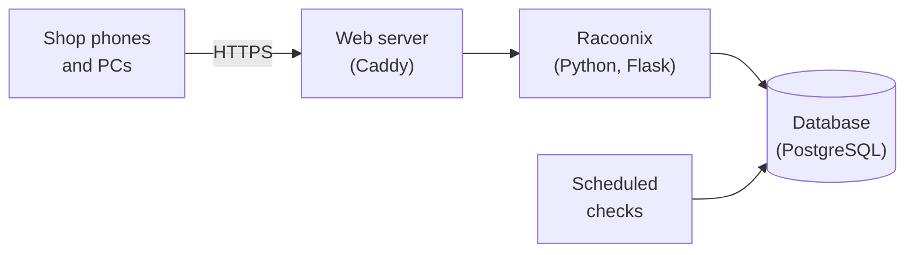

<p align="center">
  
</p>

<h1 align="center">Racoonix</h1>

<p align="center">
  <strong>Stock and expiry management for the small grocery shop that's done with throwing food away, and with running out.</strong><br>
  Expiry dates, stockroom and supplier orders, from your phone. No subscriptions, no cloud, no till to connect.
</p>

<p align="center"><a href="README.md">🇮🇹 Italiano</a> · 🇬🇧 English</p>

---

> **Language note:** the Racoonix interface is currently in **Italian**. English localisation is planned.

## In short

Racoonix is a web application that runs on a small computer inside the shop (even a Raspberry Pi) and is used from the browser of any phone or PC. It keeps track of **every batch of stock and its expiry date**, tells each person **what needs doing today** and prepares **the orders to send to suppliers**.

There's no app to install, no compatible till required, and your data **never leaves the shop**.

## Do you need Racoonix?

Probably yes, if at least one of these sounds familiar:

- 🗑️ **You throw away expired products** because nobody noticed in time that they were about to expire.
- 📒 **You write down what's running out in a notebook** by the till (when you remember to).
- 📞 **You realise you need to order when the shelf is already empty**, or you forget the day the sales rep comes round.
- 🔍 **To know how much stock you have in the back, you have to go and count it.**
- 🧾 **You don't know how much waste costs you**, or which products you throw away most often.
- 👥 **Several people work in the shop** and information gets lost between shifts.

Probably **not**, if you already have a management system connected to your till that handles batches and expiry dates, or if you only sell products that don't expire.

## What gaps it fills

| Today's problem | How Racoonix solves it |
|---|---|
| Expiry dates are discovered too late | Every batch is recorded on arrival with its expiry date. Racoonix warns you **in advance**, and on the day it expires it asks you to take it off the shelf. |
| Food that could have been sold gets thrown away | It suggests **automatic discounts** as a batch approaches its expiry date, and reminds staff to put the sticker on. |
| Shortages get forgotten | A member of staff taps **"Running low"** on their phone: if there's stock in the back, a task to refill the shelf is created, otherwise the product goes **onto the order list**. |
| Orders are made from memory | A list **split by supplier**, with each supplier's ordering days and the order text ready to send. When the goods arrive, the order closes itself. |
| Nobody knows what's in the stockroom | Only staff touch the stockroom, and every movement is recorded: the number you see **is the real one**. |
| The wrong stock goes at the front | When refilling the shelf, Racoonix shows **which batch to put at the front** (the one that expires first). |
| Waste is invisible | The dashboard shows **how much the discarded stock is worth** and **which products** you throw away most often. |
| "Who touched this?" | Every action stays in the **activity log**: who, what, when. |

## How it works, over one day

**👤 The shop assistant** opens Racoonix on their phone and finds their **to-do list**: a batch of yoghurt to check because it expires the day after tomorrow, a discount sticker to apply. If they spot an almost empty shelf, they scan the product and tap **"Running low"**. Three seconds.

**📦 The stockroom worker** receives the delivery: they scan the barcode with the camera (or a USB scanner) and Racoonix recognises the product, the batch and the expiry date, when they're printed in the code. Then they find the **"Refill the shelf"** task, showing which batch to put at the front.

**🏪 The owner** opens the **dashboard**: batches expiring in the next few days, value of waste, most discarded products, pending tasks. On the day the sales rep comes round, they open **Orders**: the list is already there, split by supplier. They approve newly arrived products, decide on discounts and manage who can access the system.

> **Why no till?** Racoonix is designed for shops that don't have (or don't want to connect) a till. Without a till, no software can know how many items customers have bought: that's why Racoonix **doesn't make numbers up**. It shows the stockroom as a reliable number and the shelf as the list of batches on display, and relies on the people working in the shop to flag what's running low.

## What it can do

- **Barcode reading**: EAN-13 and EAN-8, UPC, book and magazine codes, GS1 DataMatrix and GS1 Digital Link QR codes (with batch and expiry date), labels of products sold by weight.
- **Batches and expiry dates**, with automatic rotation: what expires first is sold first.
- **To-do lists** by role, updated in real time.
- **Discounts**, set manually on a batch or scheduled in two steps based on the days left before expiry.
- **Supplier orders** with ordering days, reorder thresholds and order text ready to send.
- **Stockroom counts**, with differences recorded automatically.
- **Dashboard** with expiry dates, waste and stockroom value.
- **Users and roles**: owner (admin), stockroom worker and shop assistant, which can also be combined.
- **Light and dark theme**, with an interface designed for phones first.

## Quick installation

You need a Linux computer that's always on in the shop, with a fixed address on the local network (a Raspberry Pi 4 or 5 is perfect), with **Docker**, **git** and **openssl**.

```bash
git clone https://github.com/JustCromo/Racoonix.git
cd Racoonix
./racoonix.sh installa
```

The installer asks **four questions** (shop name, server address, the computer you'll manage it from, Racoonix's name on the network), sets everything else up on its own and starts Racoonix. Then:

1. from your computer, open `https://racoonix.local` (or the server's IP address) and sign in as the administrator;
2. go to **Collega dispositivi** (*Connect devices*) and follow the instructions so that phones and PCs recognise Racoonix (once per device);
3. create accounts for the people who work with you under **Utenti** (*Users*). The first time they sign in, everyone chooses their own password, and you approve their phone.

Everything else takes a single command:

| Command | What it's for |
|---|---|
| `./racoonix.sh avvia` / `ferma` | Start or stop Racoonix |
| `./racoonix.sh stato` | Check that everything is working |
| `./racoonix.sh backup-automatico` | Turn on nightly backups |
| `./racoonix.sh backup` / `ripristina` | Back up right now, or restore an earlier backup |
| `./racoonix.sh aggiorna` | Update to the latest version (it takes a backup first) |
| `./racoonix.sh nome` | Announce the `racoonix.local` name on the network again (for example, if the server's IP has changed) |

### How to reach Racoonix

Racoonix has **two addresses**, and both work:

- **an easy-to-remember name**, `https://racoonix.local`. Racoonix announces it on the shop's network by itself, the way network printers do: the installer sets it up automatically, without touching the router;
- **the server's IP address**, for example `https://192.168.1.50`, which always works, everywhere.

| Device | Address to use |
|---|---|
| Windows PCs, Macs, iPhones and iPads | `https://racoonix.local` |
| Linux computers | `https://racoonix.local`, if the system can find `.local` names (many distributions already can, others need the `nss-mdns` package) |
| Android phones and tablets | the IP address: many Android devices don't look up `.local` names |

The **Collega dispositivi** page always shows both addresses, with a QR code to scan.

> **Tip:** have each device always use the same address. To the browser, the name and the IP are two different websites: switching address means signing in again and having the device approved again.

**Want the name on Android too?** If the shop's router lets you give names to devices on the network (many routers call this "local DNS" or "host name"), you can link a name to the server's IP: that name will work on any device. In that case, enter that name instead of `racoonix.local` during installation.

## Security

A management system holds data that matters: the people who work in the shop, the value of the stock, buying habits. Racoonix was designed starting from one question: **what happens if something goes wrong?** Every defence is designed to keep working even when the one before it has given way.

### Your data stays in the shop

Racoonix doesn't use external services: no cloud, no accounts to create elsewhere, nothing downloaded from the internet while you use it. Fonts, icons and libraries all live on the shop's server. Racoonix is designed to be reachable only from the local network.

### Always-encrypted connection

Every page travels over **HTTPS**, even inside the shop. Racoonix creates its own certificate, and each device installs it just once, with a digital fingerprint to check that it really is the shop's. After the first visit, the browser refuses to connect without encryption.

### Who gets in, and from where

- **No open sign-up**: accounts can only be created by the owner, and on first sign-in everyone chooses their own password.
- **Protected passwords**, using an algorithm designed specifically to make guessing attempts extremely slow, even if someone were to steal the database.
- **Approved devices**: each person can only sign in from devices the owner has approved. A stolen password, on its own, isn't enough. A revoked device is blocked immediately, for any account.
- **No clues for intruders**: when a sign-in fails, the response is always the same, whatever the reason. Someone trying to guess can't tell whether they've found the right password, or whether a user exists. Only the owner sees the real reason.
- **Limited attempts**: after a series of errors the account is locked for a while, and repeated requests are slowed down.
- **Owner functions** are only available from authorised computers, even if someone knew the password.
- **Sessions expire** after a period of inactivity, and signing out really ends them, on the server too.

### Everyone sees only their own

Roles are checked by the server on every request, not by the interface: a shop assistant can't reach the owner's pages, not even by typing in the address. The interface itself contains no logic: every decision is made by the server.

### Defence in depth

If someone ever managed to take control of the application anyway, Racoonix limits the damage:

- the application talks to the database with **the fewest permissions possible**: it can read and write the shop's data, but it can't delete tables, create users or change the structure of the database;
- **the activity log can't be changed or deleted**, not even by the application: the database itself prevents it. Someone who gets in unnoticed can't cover their tracks;
- each component runs **isolated** in its own container, with only the permissions it strictly needs and a read-only disk; the database can't be reached from the shop's network;
- **passwords and keys** are generated at random during installation and never appear in the code.

### Protection on every page

Protection against forged requests on every form, cookies that scripts can't read and that are tied to Racoonix alone, a content policy that blocks foreign code from running, protection against the page being embedded in other websites, no pages saved in the browser's cache (important on shared devices), strict checks on every piece of data typed in or read from a barcode, and exports protected against malicious formulas in spreadsheets.

### Everything is recorded

Sign-ins, failed attempts, approvals, deliveries, corrections, orders: every important action goes into the **activity log**, which the owner can consult. A security summary of the last 24 hours flags straight away if someone is trying to guess a password.

### Tested, not just claimed

The code and images are checked with automated analysis tools (code, libraries, Docker images, secrets in the repository, web scanning) and with manual testing. Vulnerabilities found during development have been fixed and verified.

> **Found a security issue?** Please don't open a public issue: contact me privately through my GitHub profile, so we can fix it before it's exploited.

## Under the bonnet

For those who want a look inside:



Python and Flask for the application, PostgreSQL for the data, Caddy for the encrypted connection, htmx for a responsive interface with no logic in the browser, Docker to run everything the same way on any computer.

## Author

Racoonix is a project by **Ivan** ([JustCromo](https://github.com/JustCromo)), created for the *System Cyber Security* course at ITS Academy Prodigi.
