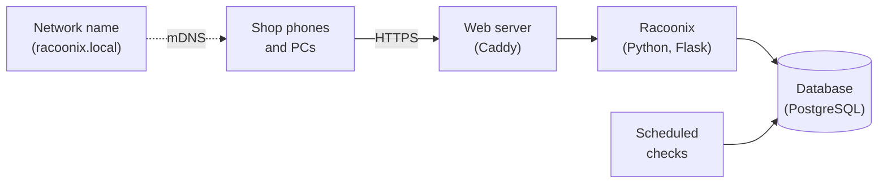

<p align="center">
  
</p>

<h1 align="center">Racoonix</h1>

<p align="center">
  <strong>Stock and expiry management for the small grocery shop that's done with throwing food away, and with running out.</strong><br>
  Expiry dates, stockroom and supplier orders, from your phone. No subscriptions, no cloud, no till to connect.
</p>

<p align="center"><a href="README.md">🇮🇹 Italiano</a> · 🇬🇧 English</p>

---

> **Languages:** Racoonix is available in **Italian and English**: each person picks their language from the menu, and dates and currency follow the shop's country (Italy, UK, US).

## In short

Racoonix is a web application that runs on a small computer inside the shop (even a Raspberry Pi) and is used from the browser of any phone or PC. It keeps track of **every batch of stock and its expiry date**, tells each person **what needs doing today** and prepares **the orders to send to suppliers**.

There's no app to install, no compatible till required, and your data **never leaves the shop**.

## Do you need Racoonix?

Probably yes, if at least one of these sounds familiar:

- 🗑️ **You throw away expired products** because nobody noticed in time that they were about to expire.
- 📒 **You write down what's running out in a notebook** by the till (when you remember to).
- 📞 **You realise you need to order when the shelf is already empty**, or you forget the day the sales rep comes round.
- 🔍 **To know how much stock you have in the back, you have to go and count it.**
- 🧾 **You don't know how much waste costs you**, or which products you throw away most often.
- 👥 **Several people work in the shop** and information gets lost between shifts.

Probably **not**, if you already have a management system connected to your till that handles batches and expiry dates, or if you only sell products that don't expire.

## What gaps it fills

| Today's problem | How Racoonix solves it |
|---|---|
| Expiry dates are discovered too late | Every batch is recorded on arrival with its expiry date. Racoonix warns you **in advance**, and on the day it expires it asks you to take it off the shelf. |
| Food that could have been sold gets thrown away | It suggests **automatic discounts** as a batch approaches its expiry date, and reminds staff to put the sticker on. |
| Shortages get forgotten | A member of staff taps **"Running low"** on their phone: if there's stock in the back, a task to refill the shelf is created, otherwise the product goes **onto the order list**. |
| Orders are made from memory | A list **split by supplier**, with each supplier's ordering days and the order text ready to send. When the goods arrive, the order closes itself. |
| Nobody knows what's in the stockroom | Only staff touch the stockroom, and every movement is recorded: the number you see **is the real one**. |
| The wrong stock goes at the front | When refilling the shelf, Racoonix shows **which batch to put at the front** (the one that expires first). |
| Waste is invisible | The dashboard shows **how much the discarded stock is worth** and **which products** you throw away most often. |
| "Who touched this?" | Every action stays in the **activity log**: who, what, when. |

## How it works, over one day

**👤 The shop assistant** opens Racoonix on their phone and finds their **to-do list**: a batch of yoghurt to check because it expires the day after tomorrow, a discount sticker to apply. If they spot an almost empty shelf, they scan the product and tap **"Running low"**. Three seconds.

**📦 The stockroom worker** receives the delivery: they scan the barcode with the camera (or a USB scanner) and Racoonix recognises the product, the batch and the expiry date, when they're printed in the code. Then they find the **"Refill the shelf"** task, showing which batch to put at the front.

**🏪 The owner** opens the **dashboard**: batches expiring in the next few days, value of waste, most discarded products, pending tasks. On the day the sales rep comes round, they open **Orders**: the list is already there, split by supplier. They approve newly arrived products, decide on discounts and manage who can access the system.

> **Why no till?** Racoonix is designed for shops that don't have (or don't want to connect) a till. Without a till, no software can know how many items customers have bought: that's why Racoonix **doesn't make numbers up**. It shows the stockroom as a reliable number and the shelf as the list of batches on display, and relies on the people working in the shop to flag what's running low.

## What it can do

- **Barcode reading**: EAN-13 and EAN-8, UPC, book and magazine codes, GS1 DataMatrix and GS1 Digital Link QR codes (with batch and expiry date), labels of products sold by weight.
- **New products filled in automatically**: on booking in, name, brand and size come from [Open Food Facts](https://world.openfoodfacts.org), the open food products database (only the barcode leaves the shop, and it can be turned off).
- **New products filled in automatically**: on booking in, name, brand and size come from [Open Food Facts](https://world.openfoodfacts.org), the open food products database (only the barcode leaves the shop, and it can be turned off).
- **Batches and expiry dates**, with automatic rotation: what expires first is sold first.
- **To-do lists** by role, updated in real time.
- **Discounts**, set manually on a batch or scheduled in two steps based on the days left before expiry.
- **Supplier orders** with ordering days, reorder thresholds and order text ready to send.
- **Stockroom counts**, with differences recorded automatically.
- **Dashboard** with expiry dates, waste and stockroom value.
- **Users and roles**: owner (admin), stockroom worker and shop assistant, which can also be combined; first sign-in with a QR code.
- **Fast booking in**: rapid booking, quantities suggested from the order with differences flagged, and "Undo" for one minute after booking in or restocking.
- **Actionable to-do list**: restock the shelf, approve a device or a product straight from the notification.
- **System status** on the dashboard: version, last backup and free space.
- **Light and dark theme**, with an interface designed for phones first.

## Quick installation

You need a Linux computer that's always on in the shop, with a fixed address on the local network (a Raspberry Pi 4 or 5 is perfect), with **Docker** and **git**. Nothing else: nothing to install on the system, no administrator rights.

```bash
git clone https://github.com/JustCromo/Racoonix.git
cd Racoonix
./racoonix.sh install
```

The installer asks no questions: it sets everything up on its own, starts Racoonix and finally shows a **personal link** (also as a QR code). Then:

1. open that link from your computer: the **guided setup** opens, where you pick country, language and time zone with a click, name your shop and create your account. The link works once only: if you need it again, `./racoonix.sh link`;
2. go to **Collega dispositivi** (*Connect devices*) and follow the instructions so that phones and PCs recognise Racoonix (once per device);
3. create accounts for the people who work with you under **Users** and have them scan the **QR code** shown: they choose their own password and their phone is already approved. A temporary password is also available.

Name, language, country and time zone can be changed at any time from **Shop**, in the menu.

Everything else takes a single command:

| Command | What it's for |
|---|---|
| `./racoonix.sh start` / `stop` | Start or stop Racoonix |
| `./racoonix.sh status` | Check that everything is working |
| `./racoonix.sh auto-backup` | Turn on nightly backups |
| `./racoonix.sh backup` / `restore` | Back up right now, or restore an earlier backup |
| `./racoonix.sh update` | Update to the latest version (it takes a backup first) |
| `./racoonix.sh link` | Show the guided setup link again |
| `./racoonix.sh name NAME` | Change Racoonix's name on the network (`racoonix.local` by default) |

### How to reach Racoonix

Racoonix has **two addresses**, and both work:

- **an easy-to-remember name**, `https://racoonix.local`. Racoonix announces it on the shop's network by itself, the way network printers do, without touching the router or the server;
- **the server's IP address**, for example `https://192.168.1.50`, which always works, everywhere.

| Device | Address to use |
|---|---|
| Windows PCs, Macs, iPhones and iPads | `https://racoonix.local` |
| Linux computers | `https://racoonix.local`, if the system can find `.local` names (many distributions already can, others need the `nss-mdns` package) |
| Android phones and tablets | the IP address: many Android devices don't look up `.local` names |

The **Collega dispositivi** page always shows both addresses, with a QR code to scan.

> **Tip:** have each device always use the same address. To the browser, the name and the IP are two different websites: switching address means signing in again and having the device approved again.

**Want the name on Android too?** If the shop's router lets you give names to devices on the network (many routers call this "local DNS" or "host name"), you can link a name to the server's IP: that name will work on any device. In that case, give Racoonix that name with `./racoonix.sh name`.

## Security

Racoonix was designed starting from one question: **what happens if something goes wrong?** In short:

- **your data stays in the shop**, and the connection is always encrypted;
- **sign-in only from approved devices**, and the initial setup is protected by a one-time code;
- **defence in depth**: least privilege, tamper-proof activity log, isolated components;
- **tested**, with automated tests, scans and manual testing.

The details, and how to report a vulnerability privately, are in **[SECURITY.md](SECURITY.md)**.

## Under the bonnet

For those who want a look inside:



Python and Flask for the application, PostgreSQL for the data, Caddy for the encrypted connection, htmx for a responsive interface with no logic in the browser, Docker to run everything the same way on any computer.

## Author

Racoonix is a project by **Ivan** ([JustCromo](https://github.com/JustCromo)), created for the *System Cyber Security* course at ITS Academy Prodigi.
