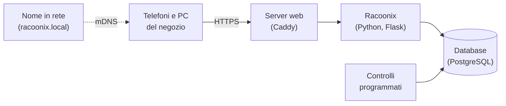

<p align="center">
  
</p>

<h1 align="center">Racoonix</h1>

<p align="center">
  <strong>Il gestionale per il piccolo negozio di alimentari che non vuole più buttare merce, né restare senza.</strong><br>
  Scadenze, magazzino e ordini ai fornitori, dal telefono. Senza abbonamenti, senza cloud, senza cassa da collegare.
</p>

<p align="center">🇮🇹 Italiano · <a href="README.en.md">🇬🇧 English</a></p>

---

## In breve

Racoonix è un'applicazione web che gira su un piccolo computer dentro il negozio (anche un Raspberry Pi) e si usa dal browser di qualunque telefono o PC. Tiene traccia di **ogni lotto di merce e della sua scadenza**, dice a ciascuno **cosa c'è da fare oggi** e prepara **gli ordini da mandare ai fornitori**.

Non serve installare app, non serve una cassa compatibile e i dati **non escono mai dal negozio**.

## Ti serve Racoonix?

Probabilmente sì, se ti riconosci in almeno una di queste situazioni:

- 🗑️ **Butti prodotti scaduti** perché nessuno si è accorto in tempo che stavano per scadere.
- 📒 **Le mancanze le segni su un quaderno** vicino alla cassa (quando ti ricordi di farlo).
- 📞 **Ti accorgi di dover ordinare quando lo scaffale è già vuoto**, o ti dimentichi il giorno in cui passa l'agente.
- 🔍 **Per sapere quanta merce hai in magazzino devi andare a contarla.**
- 🧾 **Non sai quanto ti costano gli sprechi**, né quali prodotti butti più spesso.
- 👥 **Più persone lavorano in negozio** e le informazioni si perdono tra un turno e l'altro.

Probabilmente **no**, se hai già un gestionale collegato alla cassa che gestisce lotti e scadenze, o se vendi solo prodotti che non scadono.

## Che buchi tappa

| Il problema di oggi | Come lo risolve Racoonix |
|---|---|
| Le scadenze si scoprono troppo tardi | Ogni lotto viene registrato all'arrivo con la sua scadenza. Racoonix avvisa **in anticipo**, e il giorno della scadenza chiede di toglierlo. |
| Si butta merce che si poteva vendere | Propone **sconti automatici** quando un lotto si avvicina alla scadenza, e ricorda di mettere il bollino. |
| Le mancanze si dimenticano | Il dipendente tocca **"Sta finendo"** sul telefono: se c'è merce in magazzino parte il compito di riempire lo scaffale, altrimenti il prodotto finisce **nella lista d'ordine**. |
| Gli ordini si fanno a memoria | Una lista **divisa per fornitore**, con i giorni d'ordine di ciascuno e il testo dell'ordine pronto da inviare. Quando la merce arriva, l'ordine si chiude da solo. |
| Non si sa cosa c'è in magazzino | Il magazzino lo toccano solo i dipendenti, e ogni movimento viene registrato: il numero che vedi **è quello vero**. |
| Si mette davanti la merce sbagliata | Quando si riempie lo scaffale, Racoonix indica **quale lotto mettere davanti** (quello che scade prima). |
| Gli sprechi sono invisibili | La dashboard mostra **quanto vale la merce buttata** e **quali prodotti** butti più spesso. |
| "Chi ha toccato questo?" | Ogni operazione resta nel **registro attività**: chi, cosa, quando. |

## Come funziona, in una giornata

**👤 Il dipendente** apre Racoonix sul telefono e trova le sue **cose da fare**: un lotto di yogurt da controllare perché scade dopodomani, un bollino sconto da applicare. Se nota uno scaffale quasi vuoto, inquadra il prodotto e tocca **"Sta finendo"**. Tre secondi.

**📦 Il magazziniere** riceve la merce: inquadra il codice a barre con la fotocamera (o con il lettore USB) e Racoonix riconosce il prodotto, il lotto e la scadenza, quando sono stampati nel codice. Poi trova il compito **"Riempi lo scaffale"**, con l'indicazione del lotto da mettere davanti.

**🏪 Il titolare** apre la **dashboard**: lotti in scadenza nei prossimi giorni, valore degli scarti, prodotti più buttati, cose in sospeso. Il giorno in cui passa l'agente apre gli **Ordini**: la lista è già pronta, divisa per fornitore. Approva i prodotti nuovi arrivati, decide gli sconti, gestisce chi può accedere.

> **Perché senza cassa?** Racoonix è pensato per i negozi che non hanno (o non vogliono collegare) una cassa. Senza cassa nessun programma può sapere quanti pezzi hanno comprato i clienti: per questo Racoonix **non inventa numeri**. Mostra il magazzino come un numero certo e lo scaffale come l'elenco dei lotti presenti, e si affida a chi lavora in negozio per le segnalazioni.

## Cosa sa fare

- **Lettura dei codici**: EAN-13 ed EAN-8, UPC, codici dei libri e delle riviste, GS1 DataMatrix e QR GS1 Digital Link (con lotto e scadenza), etichette dei prodotti a peso.
- **Prodotti nuovi già compilati**: al carico, nome, marca e formato arrivano da [Open Food Facts](https://world.openfoodfacts.org), il database aperto dei prodotti alimentari (solo il codice a barre lascia il negozio, e si può spegnere).
- **Prodotti nuovi già compilati**: al carico, nome, marca e formato arrivano da [Open Food Facts](https://world.openfoodfacts.org), il database aperto dei prodotti alimentari (solo il codice a barre lascia il negozio, e si può spegnere).
- **Lotti e scadenze**, con rotazione automatica: si vende prima quello che scade prima.
- **Cose da fare** per ruolo, aggiornate in tempo reale.
- **Sconti** manuali su un lotto, o programmati a due fasce in base ai giorni che mancano alla scadenza.
- **Ordini ai fornitori** con giorni d'ordine, soglie di riordino e testo pronto da inviare.
- **Conteggio del magazzino**, con registrazione automatica delle differenze.
- **Dashboard** con scadenze, sprechi e valore del magazzino.
- **Utenti e ruoli**: titolare (admin), magazziniere e dipendente, anche combinati; primo accesso con un QR.
- **Carico veloce**: carico a raffica, quantità proposte dall'ordine con le differenze segnalate, e "Annulla" per un minuto dopo ogni carico o rifornimento.
- **Cose da fare operative**: si rifornisce lo scaffale, si approva un dispositivo o un prodotto direttamente dalla notifica.
- **Stato del sistema** in dashboard: versione, ultimo backup e spazio libero.
- **Italiano e inglese**: ogni persona sceglie la sua lingua dal menu; date e valuta seguono il paese del negozio (Italia, Regno Unito, Stati Uniti).
- **Tema chiaro e scuro**, interfaccia pensata prima di tutto per il telefono.

## Installazione rapida

Ti serve un computer Linux sempre acceso nel negozio, con un indirizzo fisso nella rete locale (va benissimo un Raspberry Pi 4 o 5), con **Docker** e **git**. Non serve altro: niente da installare sul sistema, niente permessi di amministratore.

```bash
git clone https://github.com/JustCromo/Racoonix.git
cd Racoonix
./racoonix.sh installa
```

L'installatore non fa domande: prepara tutto da solo, avvia Racoonix e alla fine mostra un **link personale** (anche come codice QR). Poi:

1. dal tuo computer apri quel link: si apre la **configurazione guidata**, dove scegli con un clic paese, lingua e fuso orario, dai un nome al negozio e crei il tuo account. Il link vale una volta sola: se ti serve di nuovo, `./racoonix.sh link`;
2. vai su **Collega dispositivi** e segui le istruzioni per far riconoscere Racoonix a telefoni e PC (una volta sola per dispositivo);
3. crea gli account di chi lavora con te da **Utenti** e fai inquadrare il **QR** che compare: scelgono la loro password e il telefono è già approvato. In alternativa c'è la password temporanea.

Nome, lingua, paese e fuso orario si cambiano quando vuoi da **Negozio**, nel menu.

Per il resto basta un comando:

| Comando | A cosa serve |
|---|---|
| `./racoonix.sh avvia` / `ferma` | Accendere o spegnere Racoonix |
| `./racoonix.sh stato` | Controllare che tutto funzioni |
| `./racoonix.sh backup-automatico` | Attivare il backup ogni notte |
| `./racoonix.sh backup` / `ripristina` | Fare un backup subito, o tornare a uno precedente |
| `./racoonix.sh aggiorna` | Passare all'ultima versione (prima fa un backup da solo) |
| `./racoonix.sh link` | Mostrare di nuovo il link della configurazione guidata |
| `./racoonix.sh nome NOME` | Cambiare il nome di Racoonix nella rete (di serie `racoonix.local`) |

### Come si raggiunge Racoonix

Racoonix ha **due indirizzi**, e funzionano entrambi:

- **un nome facile da ricordare**, `https://racoonix.local`. Racoonix lo annuncia da solo nella rete del negozio, come fanno le stampanti di rete, senza toccare niente sul router né sul server;
- **l'indirizzo IP del server**, per esempio `https://192.168.1.50`, che funziona sempre e ovunque.

| Dispositivo | Indirizzo da usare |
|---|---|
| PC Windows, Mac, iPhone e iPad | `https://racoonix.local` |
| Computer Linux | `https://racoonix.local`, se il sistema sa trovare i nomi `.local` (molte distribuzioni lo fanno già, altre richiedono il pacchetto `nss-mdns`) |
| Telefoni e tablet Android | l'indirizzo IP: molti Android non cercano i nomi `.local` |

La pagina **Collega dispositivi** mostra sempre entrambi gli indirizzi, con un QR da inquadrare.

> **Un consiglio:** fai usare a ogni dispositivo sempre lo stesso indirizzo. Per il browser, il nome e l'IP sono due siti diversi: cambiando indirizzo, bisogna rifare l'accesso e far approvare di nuovo il dispositivo.

**Due Racoonix nella stessa rete** (per esempio uno di prova) devono avere nomi diversi: l'installatore lo controlla, e propone un altro nome se `racoonix.local` è già usato.

**Vuoi il nome anche sugli Android?** Se il router del negozio permette di dare un nome ai dispositivi della rete (molti router lo chiamano "DNS locale" o "nome host"), puoi associare un nome all'IP del server: quel nome funzionerà su qualunque dispositivo. In questo caso, dai quel nome a Racoonix con `./racoonix.sh nome`.

## Sicurezza

Racoonix è progettato partendo da una domanda: **cosa succede se qualcosa va storto?** In breve:

- **i dati restano in negozio**, e la connessione è sempre cifrata;
- **si entra solo dai dispositivi approvati**, e la configurazione iniziale è protetta da un codice monouso;
- **difesa in profondità**: permessi minimi, registro attività inalterabile, componenti isolati;
- **verificato**, con test automatici, scansioni e test manuali.

I dettagli, e come segnalare una vulnerabilità in privato, sono in **[SECURITY.md](SECURITY.md)**.

## Com'è fatto

Per chi vuole guardare sotto il cofano:



Python e Flask per l'applicazione, PostgreSQL per i dati, Caddy per la connessione cifrata, htmx per un'interfaccia reattiva senza logica nel browser, Docker per far girare tutto allo stesso modo su qualunque computer.

## Per sviluppatori

### Requisiti

- **Docker Engine 24+** con **Docker Compose v2**, e **git**. Nient'altro: Python, PostgreSQL e tutte le librerie girano nei container.
- Testato su **Linux** (Arch, Ubuntu 26.04, Raspberry Pi 4/5 a 64 bit).
- Su **macOS o Windows** (Docker Desktop) indica tu l'indirizzo, perché lo script non riesce a trovarlo da solo: `./racoonix.sh installa 127.0.0.1`, poi apri `https://localhost`. Il nome `racoonix.local` è pensato per un server Linux nella rete del negozio.

### Avvio

```bash
git clone https://github.com/JustCromo/Racoonix.git
cd Racoonix
./racoonix.sh installa
```

Alla fine compare il link della configurazione guidata (vale 24 ore, una volta sola). Aprilo dal browser, accetta l'avviso sul certificato (è quello di Racoonix, creato al momento) e completa la configurazione: paese, lingua, fuso orario, nome del negozio e account admin.

### Provare con i dati demo

Per avere subito un catalogo, fornitori e codici a barre da scansionare:

```bash
docker build -t racoonix-etichette tools/barcode
docker run --rm -v ./demo:/out racoonix-etichette
docker compose run --rm --no-deps -v ./demo:/demo:ro app python -m racoonix.carica_demo /demo/catalogo_demo.json
```

Poi apri `demo/foglio_demo.html` (stampato, o su un secondo schermo) e dalla pagina **Carico** inquadra i codici con la fotocamera:
- i **DataMatrix** e i **QR** contengono già lotto e scadenza (alcuni scadono nei prossimi giorni, così partono subito le notifiche);
- un codice è di un **prodotto nuovo**, che finisce tra quelli da approvare;
- uno è un **secondo codice** di un prodotto esistente.

Per provare i ruoli, da **Utenti** crea un **dipendente** e un **magazziniere**, e accedi con loro da un altro browser o dal telefono (il dispositivo va approvato dall'admin).

### Comandi utili

| Comando | A cosa serve |
|---|---|
| `./racoonix.sh log app` | Log dell'applicazione in tempo reale |
| `./racoonix.sh stato` | Servizi attivi e versione del database |
| `docker compose build app && docker compose up -d app` | Applicare una modifica al codice |
| `./racoonix.sh backup` / `ripristina FILE` | Backup e ripristino del database |

### Servizi Docker

| Servizio | Cosa fa |
|---|---|
| `segreti` | Al primo avvio genera password e chiavi in volumi separati, poi si ferma |
| `db` | PostgreSQL 16 (immagine ufficiale + aggiornamenti di sicurezza), su rete interna |
| `migrazioni` | Applica le migrazioni del database e i permessi minimi, poi si ferma |
| `app` | Flask + gunicorn: l'applicazione |
| `scheduler` | Controlli programmati (scadenze, freschezza, sconti) |
| `caddy` | HTTPS con certificato interno e intestazioni di sicurezza; unico servizio esposto |
| `mdns` | Annuncia `racoonix.local` nella rete del negozio |

### Struttura del codice

```
app/racoonix/
├── __init__.py          avvio dell'app, intestazioni e controlli comuni
├── models.py            modelli del database (SQLAlchemy)
├── auth.py, accessi.py  login, sessioni, ruoli, dispositivi approvati
├── configurazione.py    configurazione iniziale con codice monouso
├── negozio.py           impostazioni del negozio (lingua, paese, fuso)
├── carico.py            carico merce; codici.py legge EAN, GS1 DataMatrix e Digital Link
├── inventario.py        inventario, rifornimento, conteggio, "Sta finendo"
├── notifiche.py         motore delle notifiche; notifiche_web.py le pagine
├── ordini.py, riordini.py  lista d'ordine per fornitore
├── registro.py          registro attività
├── benvenuto.py         primo accesso con il QR
├── annulla.py           annulla l'ultimo carico o rifornimento
├── openfoodfacts.py     dati dei prodotti nuovi da Open Food Facts
├── impostazioni.py      pagina Negozio
├── templates/, static/  pagine (Jinja + htmx) e stili
└── translations/        traduzione inglese
app/migrations/          migrazioni Alembic
db/, mdns/               immagini del database e dell'annuncio del nome
tools/                   etichette demo e icone
```

### Database

Lo schema, con il diagramma delle tabelle, è in **[docs/DATABASE.md](docs/DATABASE.md)**: nasce dai modelli in `app/racoonix/models.py`. Per modificarlo: cambia `app/racoonix/models.py`, poi genera la migrazione

```bash
docker compose run --rm --no-deps -v ./app:/srv migrazioni flask --app racoonix:create_app db migrate -m "descrizione"
```

controlla il file creato in `app/migrations/versions/` (i vincoli `CHECK` vanno aggiunti a mano) e riavvia: le migrazioni si applicano da sole.

### Traduzioni

I testi sono in italiano nel codice, le traduzioni in `app/racoonix/translations/`. Dopo aver aggiunto o cambiato testi:

```bash
P="docker compose run --rm --no-deps --user $(id -u):$(id -g) -v ./app:/srv app pybabel"
$P extract -F babel.cfg -k _ -k _l -k testo_negozio -k N_ -k lazy_gettext -k gettext -o messages.pot .
$P update -i messages.pot -d racoonix/translations
# traduci i testi nuovi in racoonix/translations/en/LC_MESSAGES/messages.po
$P compile -d racoonix/translations
```

## Sviluppi futuri

- **"Da consumarsi preferibilmente entro"** distinta dalla scadenza vera: oggi Racoonix le tratta tutte come scadenze rigide.
- **Unità americane** (libbre, once) e **tasse per paese** (IVA britannica, sales tax degli Stati Uniti).
- **Altre lingue**: basta un file di traduzione in più.
- **Stima dei consumi** dai conteggi e dai rifornimenti, per anticipare le mancanze.
- **Carico che riconosce l'ordine** e segnala le differenze di consegna.
- **Installabile sul telefono** come app (PWA), con notifiche push.
- **Più negozi** con un unico Racoonix.
- **Test e scansioni di sicurezza automatici** su GitHub Actions a ogni modifica.

## Riferimenti

- [Open Food Facts API](https://openfoodfacts.github.io/openfoodfacts-server/api/): dati dei prodotti alimentari
- [Flask](https://flask.palletsprojects.com/), [SQLAlchemy](https://www.sqlalchemy.org/), [Alembic](https://alembic.sqlalchemy.org/), [Flask-Babel](https://python-babel.github.io/flask-babel/)
- [PostgreSQL 16](https://www.postgresql.org/docs/16/), [Caddy](https://caddyserver.com/docs/), [htmx](https://htmx.org/), [Docker Compose](https://docs.docker.com/compose/)
- [GS1 General Specifications](https://www.gs1.org/standards/barcodes-epcrfid-id-keys/gs1-general-specifications) e [GS1 Digital Link](https://www.gs1.org/standards/gs1-digital-link): codici a barre con lotto e scadenza
- [OWASP Top 10](https://owasp.org/www-project-top-ten/) e [OWASP ASVS](https://owasp.org/www-project-application-security-verification-standard/)
- [CWE-204](https://cwe.mitre.org/data/definitions/204.html): risposte diverse che rivelano informazioni (la vulnerabilità trovata e corretta nel login)
- [RFC 9106 – Argon2](https://www.rfc-editor.org/rfc/rfc9106) e [RFC 6762 – mDNS](https://www.rfc-editor.org/rfc/rfc6762)

## Autore

Racoonix è un progetto di **Ivan** ([JustCromo](https://github.com/JustCromo)), nato per il corso *System Cyber Security* dell'ITS Academy Prodigi.
