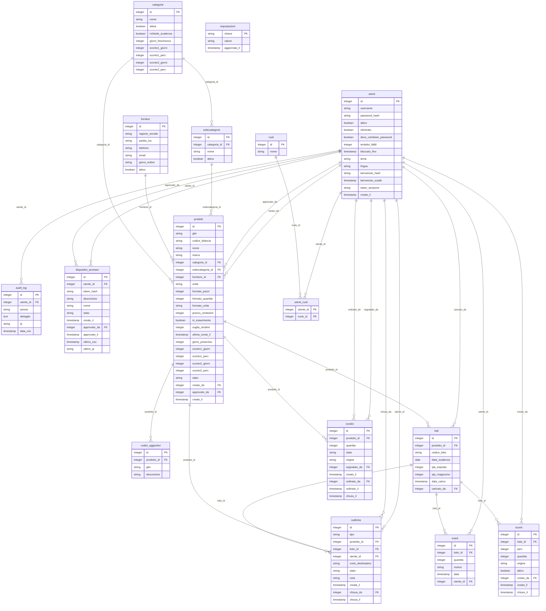

# Database

🇮🇹 <a href="#italiano">Italiano</a> · 🇬🇧 <a href="#english">English</a>

PostgreSQL 16. Lo schema nasce dai modelli in [`app/racoonix/models.py`](../app/racoonix/models.py) e viene applicato dalle migrazioni Alembic in [`app/migrations/versions`](../app/migrations/versions) a ogni avvio.
The schema comes from the models in `app/racoonix/models.py` and is applied by the Alembic migrations on every start.

## Italiano

| Tabella | A cosa serve |
|---|---|
| `audit_log` | Registro attività: chi, cosa, quando, da dove. L'app può solo aggiungere righe. |
| `categorie` | Categorie di prodotti, con le regole di scadenza, freschezza e sconto suggerito. |
| `codici_aggiuntivi` | Altri codici a barre dello stesso prodotto (per esempio una nuova confezione). |
| `dispositivi_accesso` | Dispositivi da cui ogni persona può entrare, approvati dall'admin (solo l'impronta del token). |
| `fornitori` | Fornitori, con partita IVA e giorni d'ordine. |
| `impostazioni` | Impostazioni del negozio (nome, lingua, paese, fuso, computer admin, Open Food Facts), codice di configurazione e data dell'ultimo backup. |
| `lotti` | Ogni arrivo di merce: scadenza, quantità sullo scaffale e in magazzino. |
| `notifiche` | Le cose da fare, per ruolo: scadenze, scaffali, approvazioni, ordini. |
| `prodotti` | Il catalogo: codici, formato, prezzo, fornitore, soglie e stato. |
| `riordini` | Lista d'ordine: da ordinare, ordinato, arrivato o annullato. |
| `ruoli` | admin, magazziniere, dipendente. |
| `scarti` | Merce buttata, con il motivo. |
| `sconti` | Sconti applicati ai lotti (manuali o programmati). |
| `sottocategorie` | Sottocategorie di ogni categoria. |
| `utenti` | Account: solo l'hash Argon2 della password, ruoli, blocchi, lingua, tema e impronta del codice QR di benvenuto. |
| `utenti_ruoli` | Quali ruoli ha ogni utente (anche più di uno). |

**Regole nel database**, non solo nell'app: vincoli `CHECK` su stati, quantità, partita IVA e codici; indici unici per evitare doppioni (per esempio un solo riordino aperto per prodotto); l'utente con cui gira l'app non può modificare né cancellare `audit_log`, né cambiare la struttura delle tabelle.

**Quantità in interi**: i prezzi sono in centesimi, i prodotti a peso in grammi, così non ci sono errori di arrotondamento.

## English

| Table | Purpose |
|---|---|
| `audit_log` | Activity log: who, what, when, from where. The app can only add rows. |
| `categorie` | Product categories, with expiry, freshness and suggested-discount rules. |
| `codici_aggiuntivi` | Other barcodes for the same product (for example new packaging). |
| `dispositivi_accesso` | Devices each person can sign in from, approved by the admin (token hash only). |
| `fornitori` | Suppliers, with VAT number and ordering days. |
| `impostazioni` | Shop settings (name, language, country, time zone, admin computers, Open Food Facts), setup code and last backup date. |
| `lotti` | Each delivery batch: expiry, quantity on the shelf and in the stockroom. |
| `notifiche` | To-do items by role: expiries, shelves, approvals, orders. |
| `prodotti` | The catalogue: codes, size, price, supplier, thresholds and status. |
| `riordini` | Order list: to order, ordered, arrived or cancelled. |
| `ruoli` | admin, stockroom worker, shop assistant. |
| `scarti` | Discarded stock, with the reason. |
| `sconti` | Discounts applied to batches (manual or scheduled). |
| `sottocategorie` | Subcategories of each category. |
| `utenti` | Accounts: Argon2 password hash only, roles, lockouts, language, theme and the welcome QR code hash. |
| `utenti_ruoli` | Which roles each user has (possibly more than one). |

**Rules enforced by the database**, not just by the app: `CHECK` constraints on statuses, quantities, VAT numbers and codes; unique indexes to prevent duplicates (for example one open reorder per product); the database user the app runs as can't modify or delete `audit_log`, nor change the table structure.

**Integer quantities**: prices are in cents and weighed products in grams, so there are no rounding errors.
